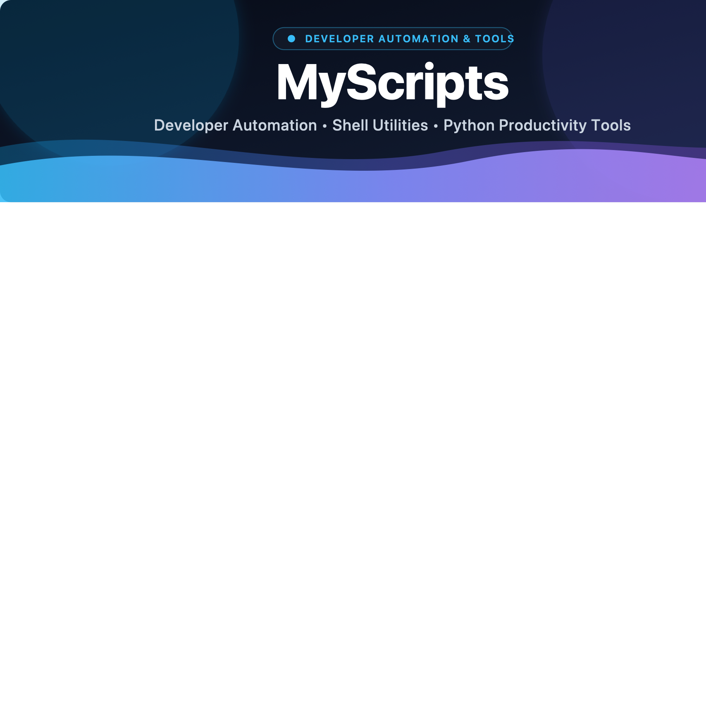

# 🚀 MyScripts Organization Profile

<!-- Native High-Performance Self-Hosted SVG Header Banner -->

<!-- Live Dynamic Metrics & Badges -->

  
  
  
  

<!-- Animated Dynamic Typing SVG -->

  

  <b>A curated arsenal of developer automation scripts, macOS productivity hacks, CLI utilities, and AI workflow accelerators designed for speed and simplicity.</b>

---

## 🌟 Repository Ecosystem & Focus

| Status | Focus Area | Description |
|:---:|:---|:---|
| 🚀 | **Production Releases** | Official open-source repositories and packages published by the team. |
| 🛠️ | **Active Engineering** | New tools, libraries, and automated workflows currently in active development. |
| 📚 | **Guides & Documentation** | Practical companion code repositories linked directly from our official articles. |

---

## 🛠️ Technology Stack & Engineering Core

---

## 🤝 Connect & Collaborate

 

Maintained with ❤️ by <a href="https://github.com/pardeeppatel">@pardeeppatel</a> and the MyScripts Team.

